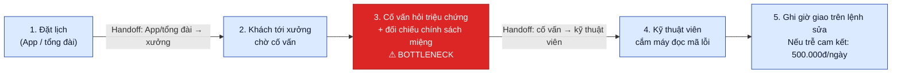

# VinFast Aftersales — Current-State Workflow

**Caption:** Current-state service intake (before fault codes): booking → workshop wait → advisor symptom/policy check (bottleneck) → technician OBD read → promised delivery time with late penalty.

